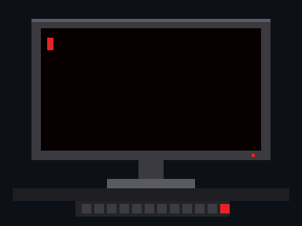

  

<table>
<tr>
<td width="62%" valign="top">

### `> whoami`

- 👋 **Rodrigo Cirino**, de Fortaleza-CE
- 🎓 Ciência da Computação na **UNIFOR**
- 💼 Software Engineer na **[MedXStudy](https://medxstudy.com.br)**
- 🛠️ Construindo o **[PocketFolio](https://devfolio-five-dusky.vercel.app)**, portfólio que se monta sozinho a partir do GitHub

</td>
<td width="38%" align="center" valign="middle">
  <!-- Para usar o seu mascote: suba o PNG/GIF em assets/ e troque o src abaixo -->
  
</td>
</tr>
</table>

### `> stack`

  
   
  

### `> projetos`

| | projeto | o que é |
|:-:|:--|:--|
| 🟥 | **[PocketFolio](https://devfolio-five-dusky.vercel.app)** | Micro-SaaS de portfólio: importa seus repos e gera a página sozinho |
| 🟥 | **[lol-mastery-hub](https://github.com/rxdrigocrn/lol-mastery-hub)** | Busca invocadores de LoL e mostra maestria e lore dos campeões (Riot API) |
| 🟥 | **[blog EFOMM](https://github.com/rxdrigocrn/frontend-bolg-efomm)** | Blog full-stack em TypeScript ([back-end](https://github.com/rxdrigocrn/backend-blog-efomm)) |
| 🟥 | **[cryptly](https://github.com/rxdrigocrn/cryptly)** | Acompanhamento de criptomoedas em React com animações GSAP |

### `> atividade`

  
    
  <!-- A cobrinha aparece depois que o workflow .github/workflows/snake.yml rodar pela primeira vez -->
  

### `> contato`

  
  
  

